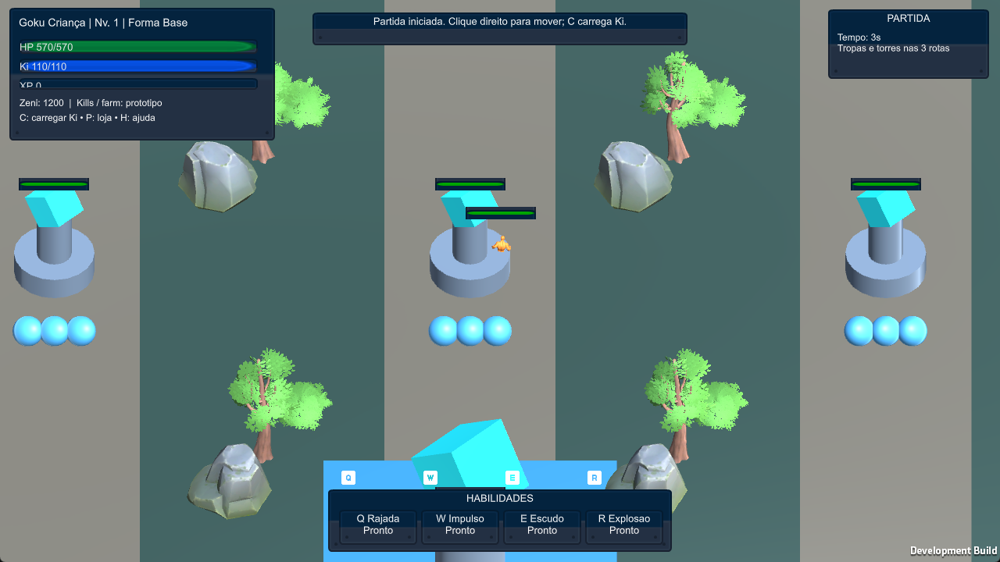
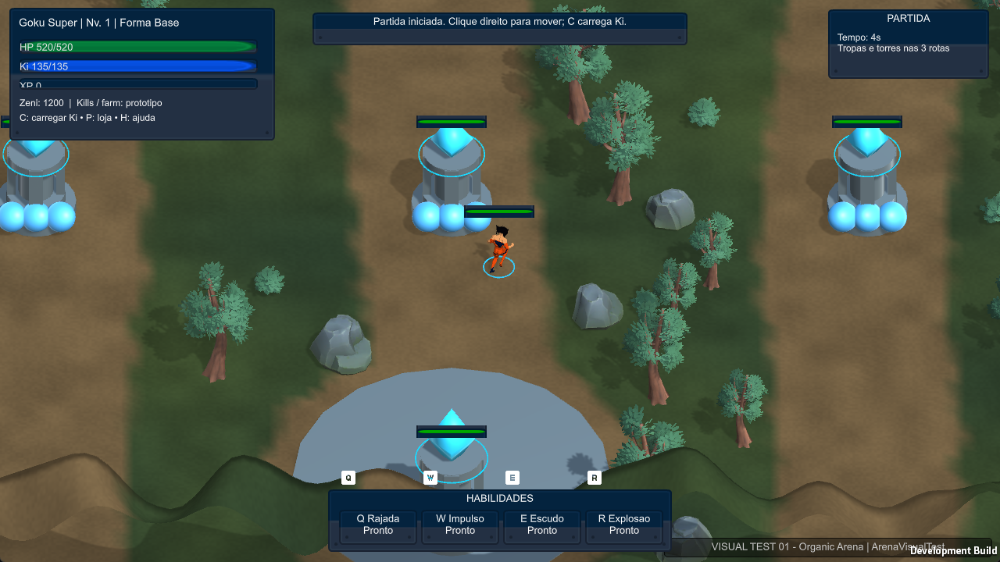
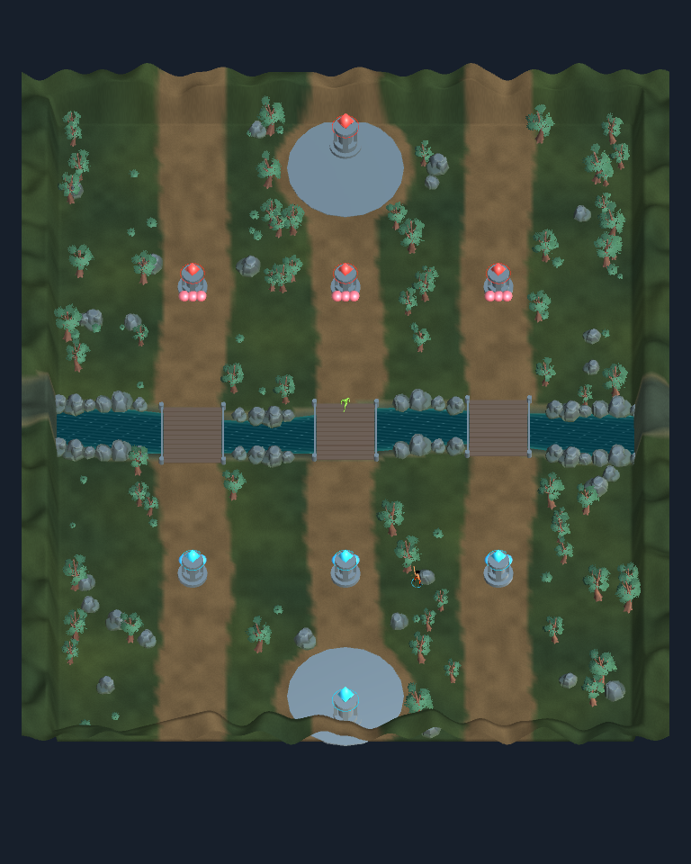

# Dragon Ball MOBA — relatório completo do trabalho realizado

**Consolidado em 16/10/2026.** Este documento reúne o trabalho registrado nesta conversa, desde a preparação do projeto para Unity 6 até a substituição visual efetivamente usada na partida e na build Windows.

O relatório foi elaborado a partir dos arquivos, relatórios, logs e evidências preservados no projeto. Esta entrega é documental: não executou uma nova compilação nem uma nova rodada de testes. Os resultados abaixo correspondem às validações já realizadas e registradas.

## 1. Resultado entregue e caminhos corretos

O projeto foi preparado para **Unity 6000.6.6f1**, mantendo o pipeline **Built-in** e o **Input Manager antigo**. A versão visual mais recente tem mapa orgânico gerado em execução, um lutador 3D animado com seis apresentações de forma, câmera controlável e as mecânicas existentes preservadas.

| Item | Localização |
| --- | --- |
| Pasta principal do trabalho | `<workspace-local>` |
| Projeto que deve ser adicionado ao Unity Hub | `<repo>\src\client-unity` |
| Cena atual, relativa ao projeto Unity | `Assets/_DragonMOBA/Scenes/VisualTest/ArenaVisualTest.unity` |
| Atalho para jogar, na pasta principal | `JOGAR_VISUAL_TEST.cmd` |
| Identificação visível na versão nova | `VISUAL TEST 01 - Organic Arena` |
| Última build registrada | 16/10/2026, 20:51:49, horário de São Paulo |
| Plataforma e tipo | Windows x64, Development Build |

**Caminho exato do novo executável:**

```text
<repo>\src\client-unity\Builds\VisualTest\DragonMobaVisualTest.exe
```

A build reportou **168.500.908 bytes no total**. Esse número corresponde ao resultado completo da compilação, não ao tamanho isolado do `.exe`. O jogo depende das pastas e arquivos que ficam ao lado dele: para transferi-lo, copie a pasta `Builds/VisualTest` inteira.

Registro da compilação: [build-info.json](../src/client-unity/Builds/VisualTest/build-info.json).

## 2. Diagnóstico e preparação para Unity 6

A pasta principal reunia kits, documentos e o código dentro de subpastas. Ela não era a raiz correta para abrir no Hub. O projeto Unity está na pasta `src/client-unity` indicada acima, onde ficam `Assets`, `Packages` e `ProjectSettings`.

O trabalho nesta etapa incluiu:

- Inventariar a estrutura e localizar o projeto, scripts, cenas, configurações e kits existentes.
- Ajustar a estrutura e os arquivos necessários para o Editor reconhecer e importar o projeto.
- Alinhar `ProjectSettings/ProjectVersion.txt` ao Editor local instalado, **6000.6.6f1**.
- Preservar Built-in e a entrada antiga, compatíveis com o código existente, sem migrar o jogo para outro pipeline.
- Configurar execução em janela, com referência inicial de 1280 × 720.
- Preparar validação por linha de comando, geração dos projetos C# e compilação Windows.
- Executar testes iniciais no Editor com os três campeões, movimento, câmera e apresentações em cena.

O Unity utilizado foi o instalado em:

```text
C:\Program Files\Unity\Hub\Editor\6000.6.6f1\Editor\Unity.exe
```

Não foi necessário instalar outro Unity, Python ou um SDK .NET global. Para a integração C#, foi usado o SDK **8.0.318** disponível no ambiente do Unity.

## 3. Preservação dos códigos e sistemas existentes

Movimento, combate, Ki, experiência, níveis, transformações, loja, IA, tropas, torres, morte, respawn e condição de vitória já faziam parte do protótipo. O trabalho aproveitou esses sistemas e acrescentou apresentação, integração e validações.

Os três arquivos de domínio abaixo permaneceram sem alteração, com hashes registrados e conferidos:

- `Assets/Scripts/Domain/Definitions.cs`
- `Assets/Scripts/Domain/EntityState.cs`
- `Assets/Scripts/Domain/GameWorld.cs`

Referência: [DOMAIN_BASELINE.csv](../src/client-unity/docs/art/DOMAIN_BASELINE.csv).

Houve alterações posteriores em `PrototypeGame.cs` e nos componentes de apresentação para ligar os novos recursos aos objetos reais da partida. Portanto, a preservação do domínio não significa que todos os scripts C# tenham permanecido byte a byte iguais.

O mundo continua sendo uma simulação local, com atualização lógica de 30 ticks por segundo. Não foi introduzido multiplayer ou servidor remoto.

## 4. Integração com VS Code e dependências

Foram preparadas as configurações de workspace, tarefas e depuração em `.vscode`, além de `global.json` para selecionar o SDK disponível. Os projetos e a solução C# são gerados pelo Unity.

A integração utiliza `com.unity.ide.visualstudio` **2.0.26**, também usado no fluxo de integração com VS Code. Não foi acrescentado o pacote antigo `com.unity.ide.vscode`.

O manifesto final mantém os módulos Unity necessários, todos em versão **1.0.0**: IMGUI, Physics, Animation, Audio, Terrain, UI, Particle System e Image Conversion. Na resolução de dependências foram registrados Test Framework **1.8.0**, NUnit **2.1.0** e JSON Serialize **1.0.0**.

As extensões Unity, C# e C# Dev Kit já estavam disponíveis no VS Code. Não foi realizada uma sessão interativa completa para comprovar todos os recursos de IntelliSense e breakpoints.

Foram acrescentadas tarefas para preparar, testar e compilar a versão visual. A tarefa `VisualBuild` passou a ser a opção padrão de build, preservando os comandos anteriores.

Arquivos de referência: [manifest.json](../src/client-unity/Packages/manifest.json) e [global.json](../global.json).

## 5. Execução do kit de arte e downloads

Foi lido o prompt `DragonBall_MOBA_AutoArte_Codex_v2/prompts/CODEX_EXECUTAR_TUDO.md` no kit existente. Os downloads possíveis foram organizados e os recursos úteis foram importados seletivamente.

Como Python não estava disponível para esse fluxo, foi preparado `inventory_unpack.ps1` em PowerShell. O script inventaria os arquivos, verifica caminhos e conteúdo dos ZIPs, evita extração fora do destino, limita os formatos importados e contorna caminhos excessivamente longos. Executáveis de terceiros não foram executados.

Foram verificados sete pacotes ZIP com recursos CC0:

| Pacote | Autor | Uso no projeto |
| --- | --- | --- |
| Universal Base Characters | Quaternius | Corpo humanoide e cabelo |
| Universal Animation Library | Quaternius | Animações retargetadas para o personagem |
| Stylized Nature MegaKit | Quaternius | Árvores, arbustos, rochas e texturas |
| UI Pack Sci-Fi | Kenney | Recursos de interface |
| Input Prompts | Kenney | Recursos de indicação de controles |
| Sci-Fi Sounds | Kenney | Efeitos sonoros selecionados |
| Impact Sounds | Kenney | Sons de impacto selecionados |

A seleção inicial importou **26 arquivos, incluindo licenças**, em vez de copiar todos os pacotes para `Assets`. Os arquivos de download e extração ficaram separados em `ExternalAssets/Staging` e `ExternalAssets/Unpacked`.

Foram organizadas pastas de personagens, animações, ambiente, VFX, UI, áudio, prefabs e cenas em `Assets/_DragonMOBA`. O registro de recursos foi atualizado com origem, hashes, status e destino de importação.

Fontes e licenças: [ASSET_MANIFEST.md](ASSET_MANIFEST.md), [ASSET_REGISTER.csv](../src/client-unity/docs/art/ASSET_REGISTER.csv) e [IMPORTED_ASSETS.csv](../src/client-unity/docs/art/IMPORTED_ASSETS.csv).

## 6. Primeira integração de personagens, efeitos e interface

Foram configurados avatares Humanoid para o corpo e a biblioteca de animações, com retargeting, repetição nos clipes apropriados e Root Motion desativado. O deslocamento continua vindo do mundo lógico do jogo.

`CharacterPresentation.cs` passou a acompanhar movimento, direção, ataque, dano, morte, respawn e carregamento de Ki. Foi corrigida a aplicação de escala do FBX, preservando sua escala original. A animação foi verificada pelo movimento real dos ossos, não apenas pela existência de um Animator.

A primeira apresentação disponibilizou as 12 formas lógicas existentes:

| Campeão lógico | Formas |
| --- | --- |
| GKU_KID | `kid_base`, `kid_nimbus`, `kid_mastery` |
| GKU_SUPER | `super_base`, `super_god`, `super_blue`, `super_blue_kk`, `super_ui_sign`, `super_ui` |
| CELL_Z | `cell_imperfect`, `cell_semi`, `cell_perfect` |

Foram adicionados efeitos de combate reutilizáveis, aura com partículas, sons selecionados e apresentação visual de torres e núcleos. O pool de efeitos foi limitado a 24 elementos; a reprodução dos sons recebeu controle de volume e intervalo.

Na interface, foi corrigido o contraste de texto branco sobre painéis claros. Também foram ajustados sobreposição de informações e apresentação da ajuda. A loja foi aberta e observada no jogo compilado.

Essa etapa produziu a cena intermediária `ArenaArt.unity` e a build `Builds/ArtWindows/DragonMobaArt.exe`, ambas preservadas como versões anteriores.

## 7. Auditoria das diretrizes e ajustes de câmera

As diretrizes visuais enviadas foram preservadas em `docs/VISUAL_DIRECTIVES.md`. A referência de mapa orgânico e personagens anime orientou a evolução visual, sem tratar o protótipo como equivalente à arte final dos jogos de referência.

Foram examinados arquivos selecionados de `yasgamesdev/MOBA_CSharp_Unity` e `tammukul/UNION-OpenSource-MOBA`: versões, licenças, câmera, movimentação, IA, combate e dependências. Também foi feita pesquisa limitada de `DevZhav/unity-moba` e de opções de floresta.

Esses repositórios permaneceram como referência. Nenhum framework antigo foi importado para os scripts compilados, e não foram instaladas suas dependências de rede ou serviços. A análise foi estática e seletiva; não corresponde a uma auditoria completa de todos os arquivos desses projetos.

Foi criado `ArenaCameraController.cs`, com zoom entre 8 e 18, seguimento, modo livre, deslocamento por setas/botão central, centralização e limites de enquadramento. Houve testes de câmera e inspeção da interface em 1280 × 720 e 1920 × 1080 na etapa intermediária. A captura nativa final da versão VisualTest foi feita em 1280 × 720.

O caso de Cell com **0/736 HP** foi investigado: no nível 5, o tempo existente de respawn é **15,5 segundos simulados**. O teste confirmou a restauração posterior; foi acrescentada contagem regressiva ao HUD. Não foi alterada a regra de respawn do domínio.

Detalhes: [VISUAL_RESTRUCTURE_AUDIT.md](VISUAL_RESTRUCTURE_AUDIT.md) e [EXTERNAL_AUDIT_SOURCES.csv](EXTERNAL_AUDIT_SOURCES.csv).

## 8. Correção principal: mudanças realmente usadas durante a partida

Foi lido integralmente `CODEX_DRAGON_MOBA_SUBSTITUICAO_VISUAL.md`. A investigação confirmou por que as primeiras importações não bastavam: o fluxo de criação do ambiente reconstruía os elementos primitivos ao iniciar a partida. Recursos presentes nas pastas não substituíam automaticamente os objetos visíveis.

A correção criou `ArenaVisualTest.unity` e ligou explicitamente o ambiente e o personagem novos aos instanciadores existentes. A nova cena foi colocada como entrada da versão visual e a compilação passou a usar essa cena de forma explícita.

### Mapa

`OrganicArena.cs` passou a gerar o mapa utilizado nessa cena, com:

- Terreno de **25.665 vértices**, variação visual de grama e solo e bordas irregulares de caminhos.
- Três rotas nas posições lógicas existentes, rio curvo com shader animado e três pontes.
- Relevo nas bordas, bases circulares e **125 instâncias de natureza**.
- Torres e núcleos com nova composição visual e cores de equipe.

Os renderizadores dos retângulos antigos foram desativados na cena nova. O collider de `Solo` foi preservado para manter o clique e o deslocamento existentes. Vegetação e rochas são decorativas; não introduzem obstáculos, pathfinding ou ocultação por arbustos.

O mapa é gerado em execução. Ao abrir a cena no Editor, é necessário entrar em **Play** para vê-lo completo.

### Personagem 3D animado

O campeão lógico **GKU_SUPER** recebeu seis referências diretas de apresentação, com corpo CC0 animado, roupa em tons laranja/azul, shader toon, cabelo ligado ao osso da cabeça, mechas originais, anel de seleção e aura transparente.

As seis formas têm variações de cabelo, materiais e aura. O controller da versão visual tem nove estados: Idle, Walk, Run, Attack, Hit, Death, Charge, Cast e Transform.

`PrototypeGame.CreateEntityVisual` passou a consultar a apresentação de `OrganicArena` antes do fallback de recursos anterior. Assim, os prefabs novos são usados pelo personagem real da partida. Kid e Cell continuam disponíveis com as apresentações anteriores.

O modelo é um **lutador genérico estilizado**, não um modelo oficial licenciado de Goku. Os testes aceleram experiência por `GameWorld.GrantExperience`; não escrevem diretamente `FormId` e não acrescentam um atalho de transformação ao jogo normal.

### Ajustes de execução

Foram corrigidos o desaparecimento visual de torres destruídas e o tamanho do núcleo, que encobria o personagem no início. A nova versão inicia com GKU_SUPER, e **Esc** retorna à seleção original dos três campeões, permitindo reiniciar.

Foi criado `JOGAR_VISUAL_TEST.cmd` na pasta principal. O selo visível de versão, o registro de build e a comparação de assemblies ajudam a distinguir o jogo novo das builds antigas.

Implementação e resultado detalhados: [VISUAL_REPLACEMENT_RESULTS.md](VISUAL_REPLACEMENT_RESULTS.md).

## 9. Automação e correções técnicas durante a validação

Foram criados ou ampliados `ProjectValidation.cs`, `PlayModeSmoke.cs`, `ArtSetup.cs`, `ArtAssets.cs`, `ArtSceneSetup.cs`, `ArtSmoke.cs`, `VisualStageChecks.cs` e `VisualReplacement.cs`, além dos componentes de execução e shaders da apresentação.

O script [validate_unity.ps1](../scripts/validate_unity.ps1) localiza o Editor pela versão do projeto, verifica bloqueios de uso, separa logs e limita o tempo de execução. Os modos finais são `VisualPrepare`, `VisualPlay` e `VisualBuild`; os modos anteriores foram preservados.

Entre os problemas encontrados e corrigidos estiveram escala de FBX, eixo usado pelo shader da roupa, APIs incompatíveis com Unity 6, sincronização de entrada em Play Mode e testes de visibilidade inadequados ao modo batch. A validação do enquadramento passou a usar o frustum da câmera, renderização e capturas reais.

O script [interactive_smoke.ps1](../scripts/interactive_smoke.ps1) foi preparado para localizar a janela pelo processo correto, conferir foco, enviar entradas e capturar a área do jogo. Ao perder o foco, cancela entradas e libera teclas pressionadas. Essa proteção limitou a sequência automática nativa completa, conforme registrado abaixo.

## 10. Testes executados e alcance das evidências

| Verificação | Resultado registrado | Alcance |
| --- | --- | --- |
| Preparação e importação da cena nova | Sucesso | `VisualPrepare`, referências de mapa e seis apresentações |
| Compilação C# e build Windows x64 | Sucesso | `VisualBuild`, build-info e arquivos gerados |
| Preservação do domínio | Sucesso | Conferência dos três hashes |
| Três campeões e 12 formas | Sucesso | Testes em Play Mode |
| Personagem efetivamente instanciado | Sucesso | Skinned mesh, marcador de apresentação, materiais e enquadramento |
| Animação real | Sucesso | Movimento dos ossos, apresentação de ações, morte e respawn |
| Movimento e solo clicável | Sucesso | Comandos no Play Mode e raycast no collider preservado |
| Q, W, E e R | Sucesso | Dano, deslocamento e escudo conforme cada comando no Play Mode |
| Carregamento de Ki e partículas | Sucesso | Estado lógico e emissão verificados no Play Mode |
| Experiência, transformação e compra | Sucesso | Comandos existentes e progressão controlada no Play Mode |
| Tropas e torres | Sucesso | Movimento, dano de torre e desaparecimento visual após destruição |
| Morte e respawn | Sucesso | Apresentação, collider e restauração; Cell com espera lógica de 15,5 s |
| Câmera, seleção e reinício | Sucesso | Limites, zoom, seguimento e retorno/reinício |
| Limite de efeitos | Sucesso | Pool limitado verificado |
| Abertura do executável final | Sucesso | Janela real capturada em 1280 × 720, com selo da versão |
| Clique direito e deslocamento no executável | Confirmados em log | Registros `RIGHT CLICK accepted=True` e `MOVEMENT CONFIRMED` |
| Loja no executável | Janela aberta e capturada | Não comprova toda a sequência de compra por automação nativa |
| Sequência física completa de Q/W/E/R/C no executável | Incompleta | Perda/negação de foco; esses comandos têm prova em Play Mode |
| Partida completa, balanceamento e desempenho prolongado | Não comprovados | Não foram concluídas avaliações desse alcance |

Os testes de gameplay usam preparações controladas de posição, HP e experiência para verificar comportamentos concretos. Isso não equivale a uma partida completa jogada do início ao fim. Também não se atribuem todos os cliques observados na janela à automação, pois houve possibilidade de interação do usuário.

Nos logs finais não houve erro de compilação C# nem exceção gerenciada de gameplay. Permaneceram mensagens de licenciamento/token e D3D que não impediram as rodadas registradas; não se afirma que todos os logs estejam sem avisos.

Logs principais, relativos à raiz Unity:

```text
Logs/Validation-VisualPrepare.log
Logs/Validation-VisualPlay.log
Logs/Validation-VisualBuild.log
Logs/Validation-Interactive-VisualTest-Final.log
Logs/Validation-Interactive-VisualTest-Executable.log
```

Evidências adicionais: [identidade dos binários](evidence/Binary-Identity.json) e [registros de movimento na build](evidence/Native-Player-Proof.txt).

## 11. Evidências visuais

A [galeria de comparação](evidence/Comparison.html) reúne antes/depois, visão geral e personagens.

**Antes — captura da build anterior:**



**Depois — janela real do executável final:**



**Visão geral do mapa em Play Mode:**



Outras imagens: [loja na nova versão](evidence/After-Executable-Shop.png), [personagem na forma base](evidence/Character-super_base.png) e [personagem na forma azul](evidence/Character-super_blue.png).

As imagens são capturas reais do jogo ou da câmera em Play Mode. Capturas da câmera não incluem o HUD IMGUI; capturas da janela incluem. Não foram usadas ilustrações geradas ou mockups como prova de execução.

## 12. Backups, checkpoints e versões preservadas

Antes da integração de arte foi criado o backup `src/client-unity/Backups/BeforeArt-20261015-192130.zip`, contendo `Assets`, `Packages` e `ProjectSettings`.

O repositório Git foi inicializado na pasta `DragonBall_MOBA_Prototype_v0_1` após a solicitação de checkpoint. Foram registrados:

| Commit | Finalidade |
| --- | --- |
| `5046d28` | Preservar o protótipo funcional antes da reestruturação visual |
| `53b7051` | Auditoria visual e câmera com limites |
| `bdf9dae` | Checkpoint antes da substituição real de mapa e personagem |
| `6f95cb3` | Substituição do ambiente em execução e personagem animado ligado à VisualTest |

Downloads, backups e saídas regeneráveis foram separados dos arquivos versionados. Os FBX selecionados necessários ao projeto foram preservados. Não foi feito push para um serviço remoto.

As cenas `ArenaPrototype.unity` e `ArenaArt.unity`, assim como as builds `Builds/Windows/DragonMoba.exe` e `Builds/ArtWindows/DragonMobaArt.exe`, foram mantidas. Elas são versões anteriores: abrir uma delas não mostra necessariamente as mudanças da VisualTest.

O guia anterior da pasta principal foi preservado em [ROOT_README_BEFORE_VISUAL_TEST.md](ROOT_README_BEFORE_VISUAL_TEST.md). Relatórios intermediários descrevem o estado de suas respectivas etapas; o resultado atual está neste documento e em `VISUAL_REPLACEMENT_RESULTS.md`.

## 13. Impedimentos encontrados e limites que permanecem

- **Nature & Ruins:** o download original retornou limite de cota. A resposta HTML foi identificada e mantida fora de `Assets`. Foi usado o Stylized Nature MegaKit CC0 como alternativa funcional.
- **Modelos de fãs no Sketchfab:** páginas de Goku, Vegeta e Cell retornaram HTTP 403. Arquivos, autoria, rig e direitos não puderam ser verificados. Esses modelos não foram incorporados.
- **Pacote de floresta da Asset Store:** não foi obtido um pacote oficial para integrar e validar. Sua compatibilidade com Unity 6 não foi afirmada.
- **Automação da janela Windows:** a perda de foco impediu completar toda a sequência nativa de teclas. Os testes de comandos no Play Mode e as capturas do executável foram concluídos nos limites descritos.
- **Arte final:** Kid e Cell ainda precisam de silhuetas próprias; o lutador novo é um humanoide genérico estilizado. Não há equivalência visual com modelos oficiais de Dragon Ball.
- **Escopo de jogo:** não foram implementados multiplayer, fog of war, ocultação por vegetação, navegação nova ou novos tipos lógicos de tropas. Também permanecem refinamentos de HUD, tropas e acabamento visual.
- **Validação ampliada:** partida completa, balanceamento, desempenho prolongado, avaliação auditiva e sessão interativa de breakpoints não foram comprovados.

## 14. Como abrir e realizar o primeiro teste

### Jogar a build pronta

1. Abra `<workspace-local>`.
2. Execute **JOGAR_VISUAL_TEST.cmd**.
3. Confira o selo **VISUAL TEST 01 - Organic Arena**. O início usa GKU_SUPER com o visual genérico novo.
4. Clique com o botão direito no chão para andar ou em um inimigo para atacar. Use **Q/W/E/R** para técnicas, **C** para carregar Ki e **P** para abrir a loja.
5. Use **H** para ajuda, a roda do mouse para zoom, setas/botão central para mover a câmera, **Espaço** para centralizar e **Y** para alternar seguimento.
6. Pressione **Esc** para voltar à seleção e testar os outros campeões existentes.

### Abrir no Unity Hub

Adicione a pasta `src/client-unity` pelo caminho completo da seção 1, escolha **Unity 6000.6.6f1**, abra `Assets/_DragonMOBA/Scenes/VisualTest/ArenaVisualTest.unity` e pressione **Play**. A geração do ambiente acontece durante a execução.

### Repetir os testes automatizados

Com o projeto fechado no Editor, abra um terminal na pasta:

```text
<repo>
```

Execute, em ordem:

```powershell
powershell -NoProfile -ExecutionPolicy Bypass -File scripts/validate_unity.ps1 -Mode VisualPrepare
powershell -NoProfile -ExecutionPolicy Bypass -File scripts/validate_unity.ps1 -Mode VisualPlay
powershell -NoProfile -ExecutionPolicy Bypass -File scripts/validate_unity.ps1 -Mode VisualBuild
```

Esses comandos podem atualizar arquivos gerados, logs e a build. Os testes e a compilação descritos neste relatório já foram executados anteriormente; repeti-los é opcional.
