# ART-002 — capturas e áudio para avaliação

**Capturas reais da janela Windows, sem retoque, incluindo IMGUI/HUD.** Não são RenderTextures ou imagens geradas por IA. Bases CC0 existentes e geometria/código originais; sem assets extraídos de jogos.

Código final `f4aedc087ed960a6fe820c76655d0610a2c8dbb5`. Menu 720p/1080p, retorno e HUD 1080p são da build final de 21:19 UTC. Gameplay/FPS 720p são da build de 21:08 UTC: mesmo mapa/áudio/movimento; depois mudaram apenas alinhamento da galeria e cabelo de Super.

## Seleção e personagens

Antes, build recebida:

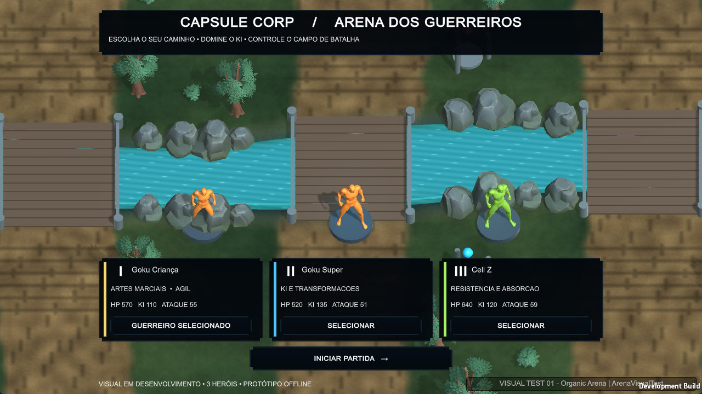

Depois:

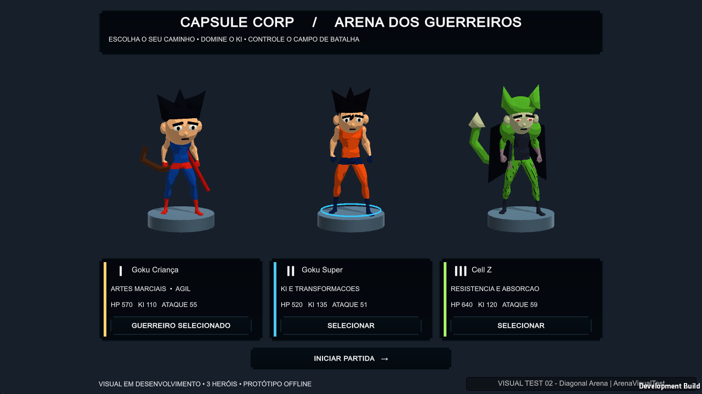

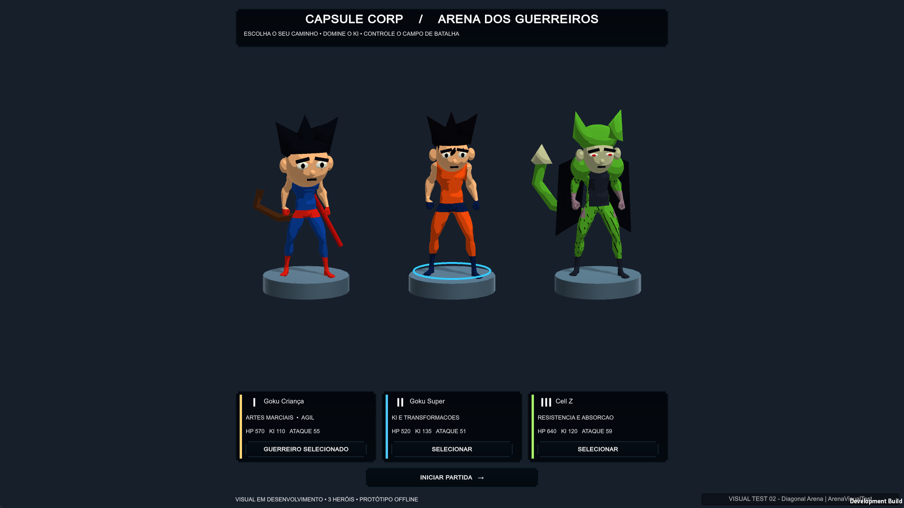

[Retorno ao menu 1080p](Menu-return-1080.png). Identidades diferenciadas, acabamento ainda intermediário; aprovação artística pendente.

## Mapa, rio e ponte

Visão geral com câmera **diagnóstica** superior (`overview:1`); não é a perspectiva normal. Arena original 144×144 unidades Unity, sem afirmar equivalência métrica ao mapa de LoL.

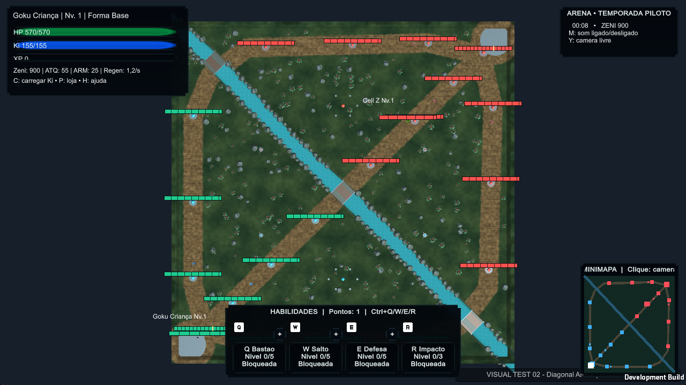

Perspectiva normal, foco deslocado por diagnóstico:

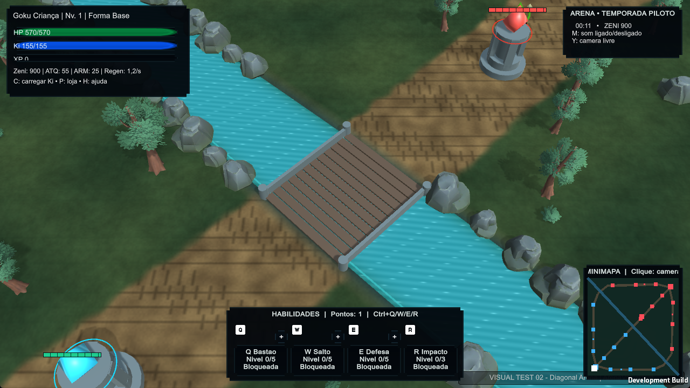

## Combate, tropas e santuário

Combate real de Kid: Q aceito, consumo de Ki, cooldown e alvo atingido. Não comprova transformação/vitória.

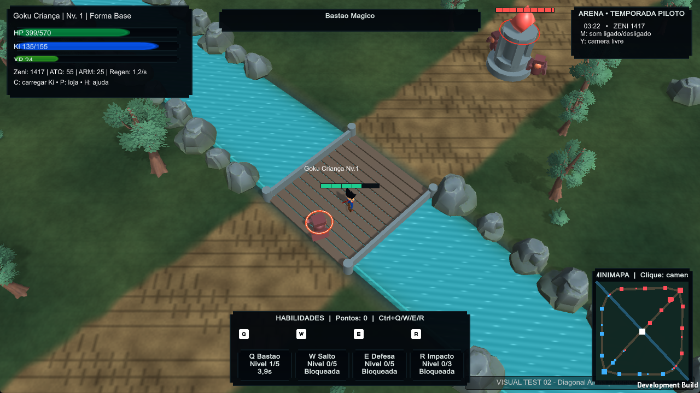

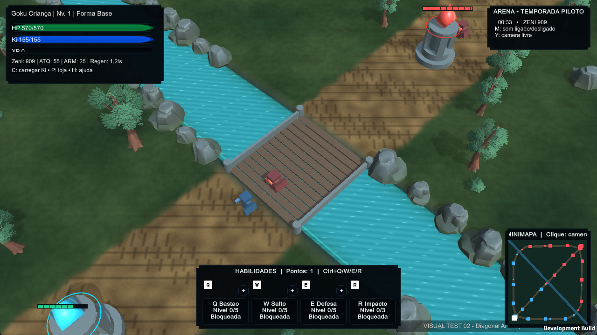

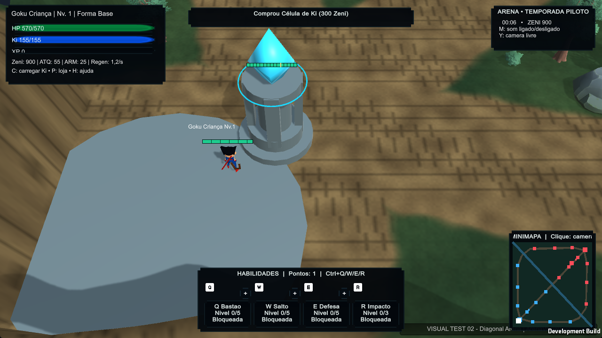

## HUD e loja

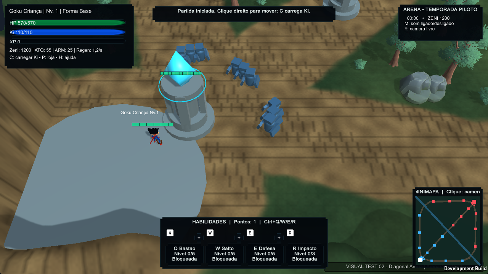

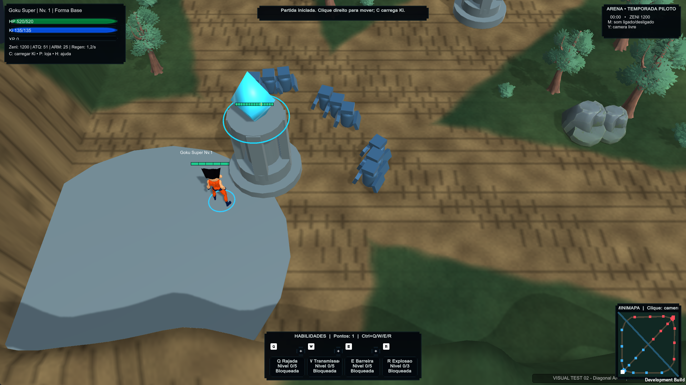

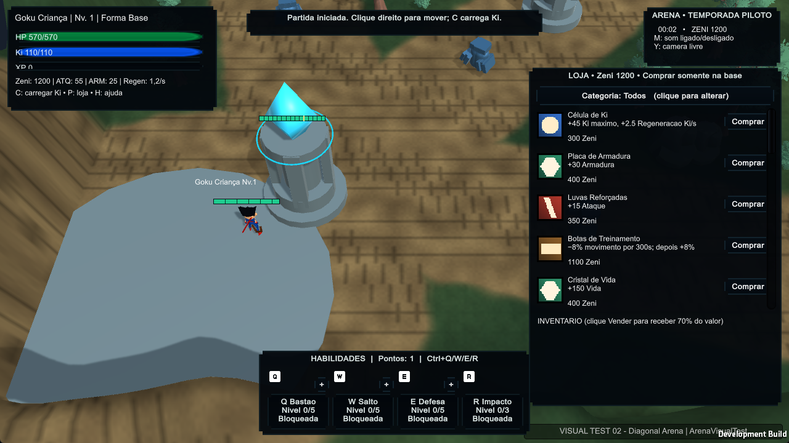

## Amostras para ouvir

- [Ambiente/interface, 24 s](ambient-after.wav): composição completa tem 48 s; gravação cobre parte dela.
- [Efeitos, 12 s](effects-after.wav): audição diagnóstica de compra, ataque, dano, carga, transformação e vitória pela rota sonora real; sem alegar ocorrência destes eventos na partida.
- [Polifonia seguida de M, 5 s](mute-polyphony-after.wav): prefixo audível, seguido de silêncio; habilidade disparada enquanto muted também silenciosa.
- [Métricas PCM16](Audio-metrics.txt): `arquivo|início_s|fim_s|pico|RMS|amostras_saturadas`. WAVs anteriores preservados nos logs locais.

Mistura mono 48 kHz do listener do jogo, sem microfone. Zero saturação nas amostras não certifica toda combinação estéreo ou equipamento de reprodução. O Codex não afirma ter ouvido: timbre, repetição e equilíbrio final dependem da avaliação humana. Usuário considerou a versão inicial melhor, mas ainda ruim.

[FPS 720p](FPS-720.json), [FPS 1080p](FPS-1080.json), [resultados Windows](Native-results.json), [build Windows testada](Native-build-info.json), [build final](build-info.json). Tropas são contagem mundial; renderers não são draw calls. FPS próximo de 240 pode refletir limite da máquina.
