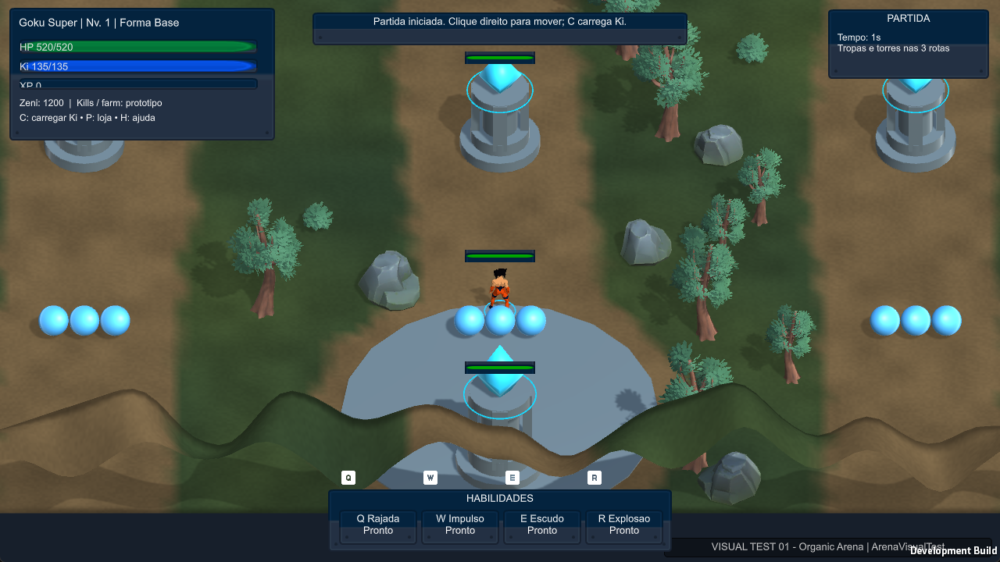

# DBM-000 — publicação inicial segura

- **Data e responsável:** 2026-10-16, Codex, Windows local.
- **Objetivo:** publicar os fontes do Unity existente e os documentos mestres, preservando coordenação, funcionalidade e licenças.
- **Status:** concluída. Não foram iniciadas correções de gameplay da DBM-001.
- **Branch de preparação:** `codex/DBM-000-publicacao-inicial`; entrega centralizada em `main` por avanço sem força.
- **Base remota inicial:** `1ba278a263df470a0265f229973561f8792e90df`.
- **Commit dos fontes:** [`04e33a986c7c545c5ae855f7ba4ef1a246ec9a8f`](https://github.com/AntonioCiorceroJunior/dragon_ball_moba/commit/04e33a986c7c545c5ae855f7ba4ef1a246ec9a8f).
- **Árvore dos fontes:** `06dfbbb6653deb2adfa7706d3574fdf1f9c9ab6e`, idêntica ao índice revisado localmente.
- **Commit de handoff:** o commit que adiciona este relatório, atualiza FROM_CODEX/PROJECT_STATUS e preserva os bytes das licenças é descendente direto do commit dos fontes; seu SHA pode ser consultado no histórico deste arquivo. O próprio relatório não incorpora seu hash recursivamente.
- **Snapshot local de origem:** `6f95cb36a64ce93a405c3986bd1ce30c4b9c6fa0`. O histórico Git local anterior foi preservado na máquina, sem ser transplantado para o remoto.

## O que foi implementado

Foi criada uma cópia limpa do remoto dentro da pasta autorizada, mantendo o layout `src/client-unity` e os caminhos esperados pelos scripts. Dos 427 arquivos originalmente versionados, 414 foram selecionados para a importação inicial; o snapshot original somava 45.324.908 bytes. Não se copiou o `.git` antigo.

Os arquivos remotos `AGENTS.md`, `docs/coordination/README.md`, `TO_CODEX.md`, `TASK_QUEUE.md`, `DECISIONS.md` e `REPORT_TEMPLATE.md` permaneceram intactos. O `.gitignore` remoto foi ampliado com exclusões locais, sem substituir suas regras.

Foram publicados código C#, cenas, prefabs, shaders, materiais, animações, recursos licenciados, `.meta`, configurações e scripts de validação. Os **19 arquivos C# do Unity** são iguais aos do protótipo original; `Definitions.cs`, `EntityState.cs` e `GameWorld.cs` mantêm os três hashes de referência. Não se refez mapa, personagem ou mecânica.

O README identifica o Unity, a cena real, o executável gerado e os comandos de teste. Foram acrescentados um launcher relativo ao clone, tarefas VS Code e verificação de publicação. O verificador Python de documentação foi adaptado aos caminhos canônicos e ao protocolo novo; Python não foi instalado para executá-lo.

Na pasta principal local foi acrescentado um `AGENTS.md` de encaminhamento e um aviso no README para apontar ao repositório ativo. As tarefas/solução VS Code e o launcher da pasta principal também passaram a apontar à cópia ativa. Esses ajustes locais não alteram as regras remotas. O protótipo anterior e suas builds foram preservados.

## Estrutura publicada

```text
AGENTS.md                           regras remotas preservadas
README.md                           abertura, build e controles
.gitignore / .gitattributes          exclusões e integridade dos arquivos
.vscode/                            tarefas e depuração
JOGAR_VISUAL_TEST.cmd                abre a build local após compilar
scripts/                            validações Unity e de publicação
src/client-unity/
  Assets/                           código, cenas, prefabs e assets licenciados
  Packages/                         manifest e lock de dependências
  ProjectSettings/                  Unity 6000.6.6f1 e configurações
  docs/art/                         registros de procedência e hashes
docs/specifications/                documentos mestres e proveniência
docs/coordination/                  protocolo, estado, handoff e relatório
docs/coordination/evidence/DBM-000/  provas desta execução
docs/evidence/                      capturas históricas preservadas
```

## Documentos mestres

As versões Markdown existentes foram importadas para `docs/specifications/`, sem inventar documentos ausentes:

| Destino | Origem |
| --- | --- |
| `GAME_DESIGN.md` | `docs/GDD_MASTER.md` do protótipo |
| `TECH_ARCHITECTURE.md` | `docs/ARCHITECTURE_GUIDE.md` do protótipo |
| `CODEX_WORKFLOW.md` | `docs/CODEX_WORKFLOW.md` do protótipo |
| `VISUAL_DIRECTIVES.md` | Diretrizes posteriores preservadas no protótipo |
| `ART_PIPELINE.md` | `docs/ART_DIRECTION.md` do kit Art Starter v1 |
| `ASSETS_PRIORITARIOS.md` | Documento de prioridades do mesmo kit |

Os caminhos originais dos quatro documentos movidos receberam ponteiros para a versão canônica, evitando duplicar os mestres. [IMPORT_SOURCES.csv](../../specifications/IMPORT_SOURCES.csv) registra origem e SHA-256 original. O relatório completo anterior também foi publicado com os caminhos pessoais substituídos por marcadores; relatórios históricos foram identificados como tal.

## Segurança, licenças e arquivos excluídos

O remoto foi confirmado como **público**, e a publicação restringiu-se ao material revisado. Sete documentos/registros históricos tiveram caminhos pessoais sanitizados na cópia pública; os originais locais foram preservados.

Os sete pacotes de origem são CC0: Universal Base Characters, Universal Animation Library e Stylized Nature MegaKit de Quaternius; UI Pack Sci-Fi, Input Prompts, Sci-Fi Sounds e Impact Sounds de Kenney. O subconjunto importado contém **26 arquivos de recursos/licenças**, com sete avisos de licença. Fontes e uso estão em [ASSET_MANIFEST.md](../../ASSET_MANIFEST.md) e nos CSVs em `src/client-unity/docs/art/`.

O maior arquivo é `Assets/_DragonMOBA/Art/Animations/Humanoid.fbx`, com **20.623.420 bytes**, necessário ao Animator existente e abaixo do limite de revisão de 50 MiB adotado nesta publicação. Não foi necessário instalar Git LFS, SDK global ou framework novo.

Não foram publicados: Library, Temp, Logs completos, Builds, UserSettings, backups, ZIPs/instaladores, downloads, clones de pesquisa, credenciais ou histórico `.git` interno. Modelos de fãs bloqueados ou de licença incerta e assets de jogos comerciais não foram enviados. Nomes lógicos de campeões e referências de design não correspondem a modelos oficiais licenciados. Não se atribuiu uma nova licença geral ao código do projeto.

O script `scripts/verify_publication.ps1` verifica caminhos proibidos, padrões comuns de dados privados, tamanho, presença dos fontes, `.meta`, JSON de pacotes, avisos CC0, hashes dos recursos importados e hashes do domínio. Trata-se de verificação direcionada, não auditoria completa de segurança.

## Testes executados nesta tarefa

Comandos executados na raiz da cópia limpa, com Unity **6000.6.6f1**, Built-in, Input Manager legado e Windows x64:

```powershell
powershell -NoProfile -ExecutionPolicy Bypass -File scripts/verify_publication.ps1
powershell -NoProfile -ExecutionPolicy Bypass -File scripts/validate_unity.ps1 -Mode VisualPrepare
powershell -NoProfile -ExecutionPolicy Bypass -File scripts/validate_unity.ps1 -Mode VisualPlay
powershell -NoProfile -ExecutionPolicy Bypass -File scripts/validate_unity.ps1 -Mode VisualBuild
powershell -NoProfile -ExecutionPolicy Bypass -File scripts/interactive_smoke.ps1 -Action Launch -Game VisualTest -Name DBM-000-launch
```

| Teste | Resultado observado |
| --- | --- |
| VisualPrepare | Passou; cena importada e seis prefabs do lutador ligados |
| Domínio | Passou nas verificações existentes |
| Cell nível 5 | Respawn após 15,5 segundos simulados; identidade, inventário e HP/Ki restaurados |
| VisualPlay | Passou nos três campeões e 12 formas; movimento, ossos animados, combate, Ki/XP, compra, câmera, morte/respawn, seleção, reinício e VFX limitado |
| Torres | Dano e desaparecimento visual por destruição passaram nos três campeões |
| VisualBuild | Passou; Windows x64 Development, **168.500.853 bytes totais** |
| Executável novo | Abriu em 1280 × 720; mapa, personagem e selo da versão visíveis na captura |
| Preservação C# | 19 arquivos iguais ao protótipo; três hashes de domínio iguais |
| Publicação | Verificações direcionadas passaram; 26 hashes CC0 e sete licenças |
| Checkout dos recursos | Passou com os 26 hashes após preservar bytes dos avisos de licença |
| Árvore remota dos fontes | SHA igual ao índice local revisado |

Build em **2026-10-17T00:21:32.7697390Z**, equivalente a 16/10/2026 às 21:21:32 em São Paulo. A raiz Unity é `src/client-unity`; cena usada: `Assets/_DragonMOBA/Scenes/VisualTest/ArenaVisualTest.unity`. A build fica localmente em `src/client-unity/Builds/VisualTest/DragonMobaVisualTest.exe`; não foi publicada como binário.

Evidências resumidas desta rodada:

- [VisualPrepare](../evidence/DBM-000/VisualPrepare.txt), [VisualPlay](../evidence/DBM-000/VisualPlay.txt) e [VisualBuild](../evidence/DBM-000/VisualBuild.txt).
- [build-info.json](../evidence/DBM-000/build-info.json) e [inventário](../evidence/DBM-000/inventory.txt).
- [Comparação dos 19 arquivos C#](../evidence/DBM-000/source-code-comparison.json).



A captura foi inspecionada e mostra a janela real. Nesta rodada não se repetiu uma sequência completa de teclas físicas ou uma partida inteira; a comprovação das ações de gameplay acima vem dos testes controlados em Play Mode.

## Problemas encontrados e resolução

1. **Git HTTPS local sem autenticação:** o dry-run falhou com `could not read Username ... terminal prompts disabled`. O conector GitHub já autenticado confirmou permissão de publicação. Os objetos foram publicados pelo conector, com hashes conferidos, commits descendentes da base e atualização de referência com `force=false` e SHA esperado. Não houve extração de tokens nem gravação de credenciais no projeto. O transporte difere do `git push` local pedido no roteiro; a publicação mantém o mesmo requisito de avanço sem força.
2. **Conversão de fim de linha em licenças:** o primeiro checkout de verificação detectou diferença de hash em avisos de licença. Atributo `-text` foi aplicado aos avisos CC0 e o índice foi atualizado para preservar os bytes originais. O checkout seguinte passou nos 26 hashes. Não se alterou o texto jurídico nem os modelos.
3. **Whitespace histórico/Unity:** `git diff --cached --check` encontrou espaços finais em YAML gerado e documentos importados. Foram mantidos para evitar reformatar o projeto inteiro; não são erros de compilação. A revisão não foi declarada livre desses avisos.

## Limitações, riscos e reversão

Os testes não aprovam a progressão individual de habilidades, o autoataque final, alcance/aggro de torres, colisões, inventário completo, balanceamento, desempenho prolongado ou multiplayer. Esses itens continuam na fila. Não foi realizada nova avaliação auditiva, sessão de breakpoints ou partida completa. Os verificadores Python não foram executados porque não foi instalado Python; a validação de publicação usou PowerShell e o Unity compilou/testou o C#.

A GUI do Hub não foi automatizada; a raiz contém Assets/Packages/ProjectSettings e foi aberta diretamente pelo Editor em batch, importada, testada e compilada. Para outro desenvolvedor, o README fornece o caminho a adicionar ao Hub. A única dependência de instalação é o Editor e seus pacotes/resolução de registro; não há download separado de modelos necessário ao protótipo publicado.

O risco funcional é reduzido pela ausência de alterações em C# de gameplay. Caminhos de documentação e tarefas foram adaptados à cópia limpa. Para reverter, use commits de reversão em nova tarefa; não apague histórico nem force referências. A cópia original, seus checkpoints e as builds locais anteriores continuam preservados.

## Próximo passo

Revisão do ChatGPT, seguida de instrução explícita para **DBM-001 — corrigir progressão de habilidades e autoataque**. Não houve alteração de prioridades nem reescrita de `TO_CODEX.md` ou `TASK_QUEUE.md`.
