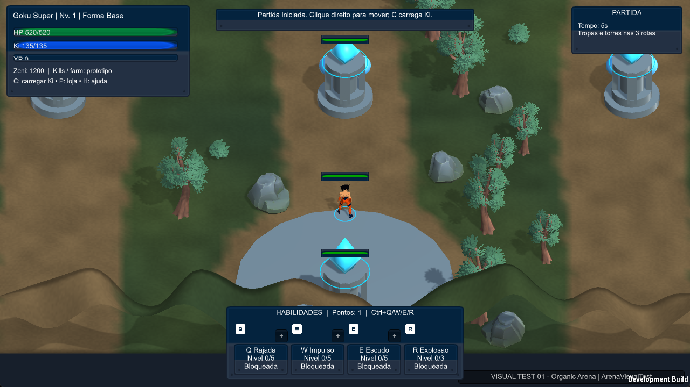

# DBM-001 — validação Unity/Windows e correção do HUD

**Data/responsável:** 2026-10-16, Codex. **Estado:** validação direcionada concluída; aguardando revisão do ChatGPT. **Sem merge.**

## Referências e commits

- Branch existente: `chatgpt/DBM-001-gameplay`; [PR #1](https://github.com/AntonioCiorceroJunior/dragon_ball_moba/pull/1), recebido como rascunho.
- Primeiro foi lida a instrução de `main`, commit `cd64b35e6ac8663b1864ddae2549139d62025a2d`. A versão anterior de TO_CODEX na branch não foi reescrita.
- Implementação do ChatGPT recebida: `089a48f5188496711b957c282776ed0fa44ec4b6`.
- Correção/testes/evidências: [`c8240a2ae33643a131ed97fe4f858a42d33acd1d`](https://github.com/AntonioCiorceroJunior/dragon_ball_moba/commit/c8240a2ae33643a131ed97fe4f858a42d33acd1d).
- Árvore revisada desse commit: `4952e7e336f9ef5dacb19bdf0db73beb68d450e6`, igual ao índice publicado.
- O commit que adiciona este relatório e atualiza FROM_CODEX/PROJECT_STATUS é descendente direto desse commit e contém somente documentação. Seu SHA está no histórico deste arquivo.

O clone estava limpo antes da troca para a branch. Não se criou implementação concorrente. A publicação usou o conector GitHub autenticado com SHA esperado e `force=false`, pois o Git HTTPS local não dispõe de credencial. Nenhum token foi extraído; **main não recebeu commits desta execução**.

## Correções e arquivos alterados

1. **PrototypeGame.cs:** corrigida falha real observada em captura: título do painel sobreposto aos botões + e texto `Nivel 0/5 | Bloqueada` cortado. O painel ganhou altura e nome/rank/estado passaram a ocupar três linhas; handlers e posição dos botões foram preservados. Acrescentado encaminhamento de eventos para a sonda opcional.
2. **DomainSelfTests.cs:** acrescentadas provas determinísticas de ataques após Q sem nova ordem e preservação de ranks/pontos após respawn. Marcador confirma o término da suíte.
3. **GameplayValidationProbe.cs + .meta:** telemetria e preparação explícita, ativadas somente por `-dbm001-native-test` sob símbolos de desenvolvimento/Editor. Sem flag, não há sonda nem mudança na partida comum.
4. **validate_native_gameplay.ps1 / interactive_smoke.ps1:** SendInput na janela do processo exato; recuperação de foco sem remover a guarda; coordenadas de cliente recalculadas; teclas liberadas e processo próprio encerrado em finally. Leitura compartilhada do log e gravação robusta de resultados.
5. **verify_publication.ps1 / nova DOMAIN_BASELINE.csv:** referência aprovada DBM-001 identificada pelo commit de origem. A referência histórica DBM-000 não foi sobrescrita. Os três arquivos de domínio recebidos **não foram alterados pelo Codex**.
6. **docs/coordination/evidence/DBM-001/:** marcadores de logs, 21 snapshots, eventos nativos, cinco capturas e identidade da build.

Nenhum sistema foi refeito. Não houve mudança intencional no mapa, pipeline de arte, multiplayer, torres/colisões ou inventário. Assets/capturas regenerados pelo Unity foram arquivados em Temp local e restaurados, evitando publicar IDs aleatórios do Animator ou sobrescrever evidências antigas. Nenhum asset/dependência foi baixado ou instalado.

## Editor, cena e executável

Raiz real: **src/client-unity**, no clone ativo `Repositorio/dragon_ball_moba` da pasta principal. Unity **6000.6.6f1**, Built-in, Input Manager legado.
Cena: `Assets/_DragonMOBA/Scenes/VisualTest/ArenaVisualTest.unity`.
Executável testado: **src/client-unity/Builds/VisualTest/DragonMobaVisualTest.exe**.

Windows x64 Development, **168.510.049 bytes totais**, UTC **2026-10-17T00:59:53.6958770Z** (16/10 às 21:59:53, São Paulo).
SHA-256 de Assembly-CSharp.dll: `854EBBAC5FBA670564B4B4EDCC5152C5538801A60ACD2168A9F8F4E7334D7384`.

O selo permanece VISUAL TEST 01; horário/hash distinguem a build da DBM-000. `JOGAR_VISUAL_TEST.cmd` abre o jogo normal, sem a flag de validação. Para transportar, copiar a pasta de build inteira. A versão anterior foi preservada em `src/client-unity/Backups/DBM-000-VisualTest`. Binários/backups não foram publicados.

O Editor foi aberto por linha de comando para importação, Play Mode e build. Não se declara sessão manual na GUI do Editor. O input foi validado na janela real do executável.

## Comandos executados

Na raiz do clone, com o projeto fechado no Editor:

```powershell
powershell -NoProfile -ExecutionPolicy Bypass -File scripts/validate_unity.ps1 -Mode VisualPrepare
powershell -NoProfile -ExecutionPolicy Bypass -File scripts/validate_unity.ps1 -Mode VisualPlay
powershell -NoProfile -ExecutionPolicy Bypass -File scripts/validate_unity.ps1 -Mode VisualBuild
powershell -NoProfile -ExecutionPolicy Bypass -File scripts/validate_native_gameplay.ps1
powershell -NoProfile -ExecutionPolicy Bypass -File scripts/verify_publication.ps1
```

O PR original passou em Prepare/Play antes das correções do Codex. Após ampliar os testes, Play passou novamente. A compilação final após corrigir o HUD passou, seguida da suíte nativa completa. `DomainSelfTests.Run` chama `RunAll`; `DBM001 DOMAIN PASSED` apareceu em Play e build.

Play Mode: três campeões/12 formas, movimento, ossos animados, QWER, Ki/XP, compra, tropas/torres, câmera, morte/respawn, seleção/reinício e pool de efeitos passaram. Cell nível5 também completou seu respawn de15,5s simulados. Nos logs finais não houve erro C# ou exceção gerenciada de gameplay. Logs completos ficaram locais; somente marcadores/eventos sem caminhos privados foram publicados.

## Verificação na janela real: 21 aprovadas, zero reprovadas

| Critério | Observado |
| --- | --- |
| Início comum | Nível1, um ponto, ranks0/0/0/0 e HUD bloqueado |
| Q bloqueada | Tecla Q registrada como rejeitada, sem custo de Ki/cooldown |
| Ctrl+Q | Rank1 e ponto consumido |
| Q aprendida | Consumo de Ki e início do cooldown |
| Q rank2 | Rejeitada no nível2; aceita no nível3 por clique esquerdo no + |
| R | Bloqueada antes de6; upgrades em6/11/16; rank seguinte rejeitado em6 e11 |
| Um clique no corpo3D | Adquire inimigo, aproxima e gera cinco ataques; intervalo mínimo33 ticks =1,1s |
| Q no autoataque | Alvo mantido e mais dois ataques, sem novo clique |
| Cancelamento | Clique no chão interrompe ataques; C limpa o alvo |
| Transformação | Corpo do inimigo cell_perfect continua selecionável após trocar de visual |
| Respawn | Dano letal preparado no nível16; timer normal, ranks e11 pontos preservados |
| Nova partida | Esc/menu/clique iniciam nível1, um ponto e habilidades bloqueadas |

O script enviou mouse/teclado pelo Windows e usou os handlers normais do HUD/PrototypeGame. **Não enviou upgrades, casts ou ataques diretamente ao domínio.**

**Preparação controlada:** XP por `GameWorld.GrantExperience` para alcançar rapidamente níveis2/3/6/11/16 e transformar o inimigo; não se escreveu FormId. Combate foi posicionado fora da rota com inimigo estacionário, sem ataques/técnicas; dano letal foi aplicado para testar respawn. Não foram alterados relógio30Hz, cooldowns ou timer de respawn. Isso é validação na partida do executável com cenários controlados, não uma partida competitiva inteira ou sessão manual de humano.

Primeiras tentativas foram inconclusivas por perda de foco, entradas externas, caminho de telemetria, coordenadas antigas e gravador de resultados. Não foram contadas como prova de falha do autoataque nem como sucesso de um clique único. Após corrigir a automação e o usuário reservar mouse/teclado, a rodada final passou integralmente. As provas publicadas correspondem à rodada final.

## Evidências

- [21 resultados/snapshots](../evidence/DBM-001/Native-results.json), [eventos do executável](../evidence/DBM-001/Native-events.txt).
- [Prepare](../evidence/DBM-001/VisualPrepare.txt), [Play](../evidence/DBM-001/VisualPlay.txt), [Build](../evidence/DBM-001/VisualBuild.txt).
- [Identidade](../evidence/DBM-001/Build-identity.json), [build-info](../evidence/DBM-001/build-info.json), [domínio aprovado](../evidence/DBM-001/DOMAIN_BASELINE.csv).
- [Q aprendida](../evidence/DBM-001/learned-Q.png), [combate](../evidence/DBM-001/combat.png), [nível16](../evidence/DBM-001/level16.png), [reinício](../evidence/DBM-001/restart.png).



Capturas inspecionadas, sem mockup. Verificação de publicação:26 hashes CC0, sete licenças, .meta, pacotes, tamanhos e padrões comuns de dados privados passaram. Não equivale a auditoria completa de segurança.

## Limites e próximo passo

Não concluídos: partida inteira, balanceamento, desempenho prolongado, multiplayer, áudio ou input físico em1920x1080. A sequência nativa usou GKU_SUPER; os outros campeões passaram em Play Mode. Não se aguardou treinamento natural até nível16. Não foi produzida build Release.

O risco funcional da correção do Codex concentra-se no layout; a preparação é opt-in de desenvolvimento. Reversão, se necessária, por novos commits sob tarefa aprovada, preservando a implementação do ChatGPT e backups; nunca reset destrutivo ou push forçado.

**ChatGPT deve revisar PR #1, resultados e limites e decidir ajustes/merge.** Nenhum merge foi feito; main, TO_CODEX e fila não foram reescritos. DBM-002 não foi iniciada.
